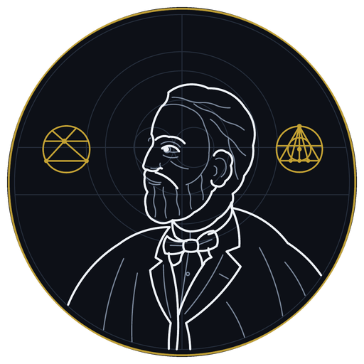

<a href="https://geometor.github.io/klein/"></a>

# GEOMETOR • klein

**Visit the Online Archive:** https://geometor.github.io/klein/

<p align="center">
  <a href="https://geometor.github.io/klein/"></a>
</p>

**Felix Klein • Erlangen Program, Famous Problems of Elementary Geometry • semantic digital archive**

## Mission

`geometor/klein` is part of the interconnected [GEOMETOR](https://geometor.com) semantic digital archive. It captures the landmark geometric treatises of Felix Klein—unifying geometry through continuous transformation groups in the *Erlangen Program* and resolving the classical problems of antiquity through Galois theory and transcendence proofs in *Famous Problems of Elementary Geometry*. Through addressable semantic units, calibrated theme-adaptive vector diagrams, primary-source folio provenance, and exact SymPy symbolic constructibility verifiers, these works speak directly to the wider GEOMETOR corpus.

## Books in This Archive

- [Famous Problems of Elementary Geometry](https://geometor.github.io/klein/famous_problems/) — Resolves the classical problems of cube duplication, angle trisection, circle division (Gauss 17-gon on a single circle), and circle quadrature via Galois theory and transcendence proofs (1895 / 1897).
- [The Erlangen Program](https://geometor.github.io/klein/erlangen_program/) — Formulates geometry as the invariant theory of transformation groups across Euclidean, affine, projective, and Cayley–Klein non-Euclidean geometries (1872 / 1893).

### Python API Quickstart

```python
import sympy as sp
from geometor.klein import (
    analyze_constructibility,
    construct_gauss_17gon_periods,
    verify_cayley_klein_additivity,
    verify_erlangen_invariants,
)

# Gauss-Wantzel & Galois constructibility checks
assert analyze_constructibility(17).is_constructible is True
assert analyze_constructibility(7).is_constructible is False
assert analyze_constructibility(sp.pi).is_constructible is False

# Exact Poncelet-Steiner single-circle regular 17-gon
res = construct_gauss_17gon_periods(inscribe_polygon=True)
assert len(res.model.circles) == 1 and len(res.vertices) == 17

# Erlangen group-hierarchy invariants
erl = verify_erlangen_invariants()
ck = verify_cayley_klein_additivity()
assert ck.multiplicative_identity_residual == 0
```
## Repository Contents

- `docsrc/` — RST documentation source, bilingual study tracks, and Sphinx codex compiled by [PHOTON publish](https://github.com/photon-platform/publish).
- `resources/` — Primary-source folios, facsimile page images, and bibliographic metadata registries.
- `src/geometor/klein/` — Exact SymPy constructibility verifiers, Erlangen group-invariant checkers, and Poncelet–Steiner regular heptadecagon engines.

## Local Build & Verification

```bash
publish build
uv run --no-sync pytest
```
## Part of the GEOMETOR Knowledge Archive

Explore all **74 Book Codices** and **11 Mathematical Catalogs** at https://geometor.com/books/.
