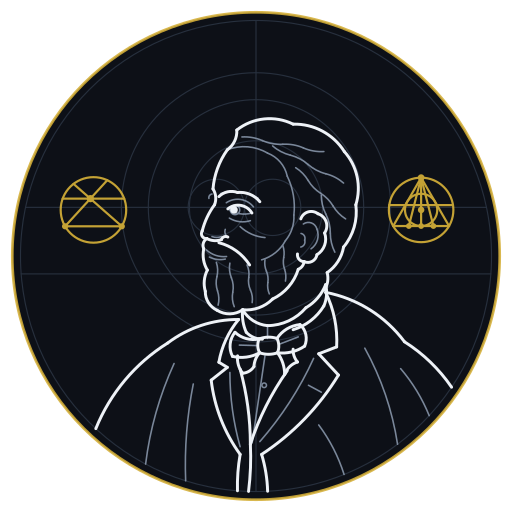

:site_title: Felix Klein

.. _klein-home:

.. container:: author-overline

   semantic digital archive • the works of

===========
Felix Klein
===========

:person:`Felix Klein <klein>` (1849–1925) unified modern geometry around two transformative ideas: that every geometry is defined by the invariants of a continuous group of transformations, and that classical compass-and-straightedge constructibility reduces to towers of quadratic field extensions. This synchronized four-track German–English archive unites both his *Famous Problems of Elementary Geometry* (1895 / 1897) and *The Erlangen Program* (1872 / 1893) with calibrated vector diagrams and exact symbolic verifiers in ``geometor.klein``.

Books in This Collection
------------------------

.. container:: home-book-hero

   .. container:: home-book-thumb

      .. image:: _static/figures/fig_gauss_17gon_circle.svg
         :alt: Gauss's Regular 17-Gon on a Single Circle in Felix Klein's Famous Problems
         :target: famous_problems/index.html

   .. container:: home-book-body

      .. rubric:: First Editions · 1895 (Teubner) / tr. Beman & Smith 1897 · Parts I & II · 4 Tracks

      **Famous Problems of Elementary Geometry (Vorträge über ausgewählte Fragen der Elementargeometrie)** — Klein's Göttingen holiday lectures resolving cube duplication, angle trisection, Gauss's constructible 17-gon (including Poncelet–Steiner single-circle construction), and Gordan's transcendence proofs for :math:`e` and :math:`\pi`.

      .. container:: home-actions

         * :doc:`Open Famous Problems → <famous_problems/index>`
         * :doc:`Part I: Algebraic Expressions → <famous_problems/part_1/index>`
         * :doc:`Part II: Transcendental Numbers → <famous_problems/part_2/index>`

.. container:: home-book-hero

   .. container:: home-book-thumb

      .. image:: _static/figures/fig_cayley_klein_metric.svg
         :alt: Cayley–Klein Projective Metric and Group Hierarchy in The Erlangen Program
         :target: erlangen_program/index.html

   .. container:: home-book-body

      .. rubric:: Inaugural Monograph · 1872 (Erlangen) / tr. Haskell 1893 · §§ 1–10 & Notes · 4 Tracks

      **The Erlangen Program (Vergleichende Betrachtungen über neuere geometrische Forschungen)** — Klein's program classifying Euclidean, affine, projective, conformal (Möbius), Cayley–Klein non-Euclidean, and topological (*analysis situs*) geometries as invariant theories of transformation groups.

      .. container:: home-actions

         * :doc:`Open The Erlangen Program → <erlangen_program/index>`
         * :doc:`§ 1: Groups of Transformations → <erlangen_program/sec_01/index>`
         * :doc:`§ 5: Transfer Principles → <erlangen_program/sec_05/index>`

Key Features
------------

.. container:: home-feature-grid

   .. container:: home-feature-card

      **Four-Track Bilingual Codices**

      Every section pairs the 1872/1895 German originals with the authorized English translations (Haskell 1893; Beman & Smith 1897), executive summaries, and mathematical notes.

   .. container:: home-feature-card

      **Symbolic Cyclotomy & Group Invariants**

      The ``geometor.klein`` Python suite verifies Gauss–Wantzel constructibility, constructs the exact single-circle 17-gon over :math:`K_{16}`, and checks Cayley–Klein cross-ratio additivity in SymPy.

   .. container:: home-feature-card

      **Nine-Corpus Concordance & Lexicon**

      The :doc:`Concordance <concordance>` links Klein's theorems across Euclid, Kepler, Hilbert, Russell, Hoenen, Lemoine, Petersen, Pappus, and Wildberger, paired with **25 glossary entries**.

Reference & Project
-------------------

.. container:: home-columns

   .. container:: home-col

      .. rubric:: Scholarly Apparatus

      * :doc:`Concordance <concordance>` & :doc:`Glossary <glossary>` — Cross-corpus matrix and 25 algebraic/group-theoretic terms
      * :doc:`People <people/index>` — Biographical profiles of 62 geometers, algebraists, and translators
      * :doc:`Bibliography <bibliography>` — 36 primary German/English editions and historical memoirs

   .. container:: home-col

      .. rubric:: About This Project

      * :doc:`About <about/index>` — Scope, textual witnesses, and Klein's algebraic-group synthesis
      * :doc:`Using This Edition <usage/index>` — Track switching and navigation guide
      * :doc:`Log <log/index>` & :doc:`Modules <modules/index>` — Development notes and ``geometor.klein`` Python API

.. toctree::
   :maxdepth: 2
   :hidden:

   famous_problems/index
   erlangen_program/index
   people/index
   bibliography
   usage/index
   log/index
   modules/index
   about/index
